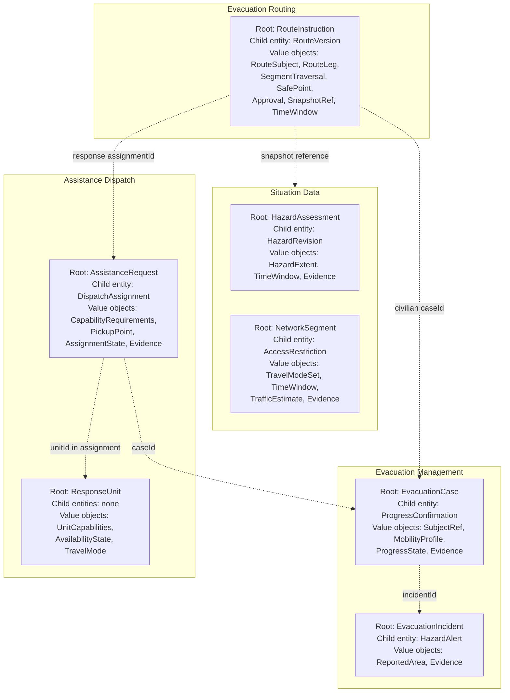
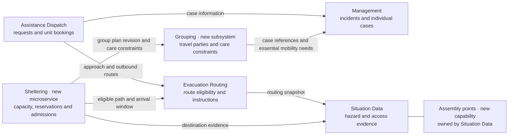
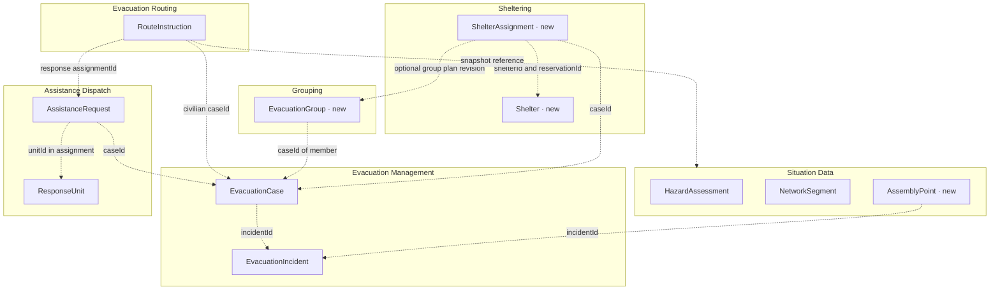

# MVP domain architecture and service contracts

This proposal uses four service boundaries for the [MVP workflows](business-processes.md). An aggregate root owns a local consistency boundary. An entity has an identity and lifecycle within that boundary. A value object is immutable and compared by value. Services own their writes and exchange IDs, snapshots and committed facts.

## Service boundaries and aggregate model

| Owner | Aggregate root and identity | Child entities | Value objects | What the root controls |
| --- | --- | --- | --- | --- |
| Evacuation Management | `EvacuationIncident(incidentId)` | `HazardAlert` | `ReportedArea`, `Evidence` | Opening and updating the incident, attributing reports and retaining alert references |
| Evacuation Management | `EvacuationCase(caseId)` | `ProgressConfirmation` | `SubjectRef`, `MobilityProfile`, `ProgressState` | One case per known subject and incident. Explicit progress confirmations and corrections. |
| Situation Data | `HazardAssessment(hazardId)` | `HazardRevision` | `HazardExtent`, `TimeWindow`, `Evidence` | Versioned hazard extents and their evidence, including reports, confirmed observations and forecasts |
| Situation Data | `NetworkSegment(segmentId)` | `AccessRestriction` | `TravelModeSet`, `TimeWindow`, `TrafficEstimate`, `Evidence` | Effective access restrictions, supported modes and time-sensitive traffic information |
| Evacuation Routing | `RouteInstruction(routeSubject)` | `RouteVersion` | `RouteSubject`, `RouteLeg`, `SegmentTraversal`, `SafePoint`, `Approval`, `SnapshotRef` | One current authorized route or bundle per civilian case or dispatch assignment. Versioning, validity and withdrawal. |
| Assistance Dispatch | `AssistanceRequest(requestId)` | `DispatchAssignment` | `CapabilityRequirements`, `PickupPoint`, `AssignmentState` | Open assistance, unit assignment history, acknowledgement, pickup, cancellation and completion |
| Assistance Dispatch | `ResponseUnit(unitId)` | — | `UnitCapabilities`, `AvailabilityState`, `TravelMode` | Unit capability and readiness for dispatch |

A `SituationSnapshot` is a versioned read model, assembled from infrastructure, hazards and population observations or estimates. It exposes source coverage and freshness. A `SafePoint` is a location eligible as an exit destination for a specific proposal, with evidence from the situation snapshot. It has no capacity, placement or stay lifecycle in the MVP.

`RouteSubject` is a tagged reference: `CivilianCase(caseId)` or `ResponseAssignment(assignmentId)`. A civilian route has an exit leg. A response route has an approach leg and, when required by the task, an outbound leg. Responders use their own authorized access profile for approach. Civilian and assisted outbound legs must account for leaving an affected area safely under applicable restrictions. The routing domain service calculates candidates and live validation checks them before publication. A route binds estimated traversal windows to its evidence revision.

## Aggregate diagram

Each box names one aggregate root and lists the child entities and value objects it owns. The surrounding boxes show service boundaries. Dotted arrows show references to another aggregate or a service's published data.

## Entities and value objects by aggregate

Each root below is also an entity. A child entity belongs to its root and changes through the root's operations. References to children use their parent identity when the child ID is local, for example `(routeSubject, versionNumber)`. A field of an entity can change through a domain operation while its identity stays the same. A value object is replaced as a whole when its value changes.

### Evacuation Management

**`EvacuationIncident` (root entity, `incidentId`).** Owns the alert history for the incident.

- **Child entity `HazardAlert(alertId)`.** Records the client alert ID, reported hazard type, `ReportedArea` and `Evidence`. A review can record a disposition on the same alert while retaining its original report.
- **Value object `ReportedArea`.** A geographic point or polygon submitted with the alert. Source and review status determine how it is shown in a situation view.

**`EvacuationCase` (root entity, `caseId`).** Tracks the evacuation of one known subject in one incident.

- **Child entity `ProgressConfirmation(reportId)`.** Records the confirmed milestone, `Evidence`, and the relevant instruction version when available. A correction is a new report referencing the earlier report. Replaying the same report ID does not advance the case twice.
- **Value objects.** `SubjectRef` is an opaque reference to the evacuee. `MobilityProfile` holds a travel mode, essential access needs and a walking limit when known. `ProgressState` holds the latest confirmed milestone and its time. Observations and delivery receipts have separate meanings from a confirmed exit.

### Situation Data

**`HazardAssessment` (root entity, `hazardId`).** Publishes revisions of an assessed hazard.

- **Child entity `HazardRevision(revisionNumber)`.** Holds a `HazardExtent` and its `Evidence`. New assessments append a revision, keeping previous revisions available to explain earlier route decisions.
- **Value objects.** `HazardExtent` combines a geometry reference with the time window it describes. `Evidence` distinguishes a reported, observed, estimated or forecast extent from its verification status.

**`NetworkSegment` (root entity, `segmentId`).** Resolves access and traffic conditions for a network segment.

- **Child entity `AccessRestriction(restrictionId)`.** Holds the restriction type, affected `TravelModeSet`, effective `TimeWindow` and `Evidence`. Changing or lifting a confirmed restriction requires an authorized update tied to its identity.
- **Value objects.** `TravelModeSet` is an immutable set of modes with order-independent equality. `TrafficEstimate` holds an estimated travel time or throughput, its unit if applicable, and timestamped evidence. Missing traffic data remain unknown.

### Evacuation Routing

**`RouteInstruction` (root entity, keyed by `RouteSubject`).** Controls the current route version for one civilian case or dispatch assignment.

- **Child entity `RouteVersion(versionNumber)`.** Identifies a route or bundle with one or more typed `RouteLeg` values, an `Approval`, a validity `TimeWindow` and a `SnapshotRef`. Its published route details stay fixed. The root can supersede or withdraw it and retains its version for reconciliation.
- **Value objects.** `RouteSubject` distinguishes a civilian case ID from a response assignment ID. `RouteLeg` contains a leg kind, travel mode, ordered `SegmentTraversal` items and an endpoint. Each traversal pairs a segment ID with its predicted time window. `SafePoint` captures the exit location and the evidence used to assess it. `Approval` records the authorizing actor, role and time. `SnapshotRef` identifies the data revision used for validation.

### Assistance Dispatch

**`AssistanceRequest` (root entity, `requestId`).** Owns the request and its assignment history.

- **Child entity `DispatchAssignment(assignmentId)`.** Records the unit ID, `AssignmentState` and progress evidence. Its globally unique ID lets Routing address the assignment. The same assignment is acknowledged, started, completed or cancelled through explicit transitions. Assigning a different unit creates a new assignment.
- **Value objects.** `CapabilityRequirements` lists the capabilities the task requires. `PickupPoint` captures the pickup location and access notes. `AssignmentState` records the current step and its effective time, with distinct states for acknowledgement, pickup and completion where applicable.

**`ResponseUnit` (root entity, `unitId`).** Owns the unit's readiness and capabilities. The active booking points to the assignment owned by `AssistanceRequest`.

- **Child entities.** The root itself carries the unit identity. The assignment stays under `AssistanceRequest`.
- **Value objects.** `UnitCapabilities` describes supported assistance and transport capabilities. `AvailabilityState` records readiness and its effective time. `TravelMode` identifies the unit's routing mode. Dispatch checks readiness and active bookings together before assigning the unit.

Across these aggregates, `Evidence` contains a source reference, observation time, evidence kind, verification status and validity where applicable. `TimeWindow` uses a UTC start and an end when known. A finite end must be later than the start, and the end is exclusive. Route instructions require a finite validity window.

## Service contracts

Names below describe version-one contracts independently of the transport. Queries return a result or an explicit pending, stale or unknown state. Commands carry an idempotency key. State-changing commands carry an expected version where concurrent edits can conflict.

| Provider or publisher | Contract | Main fields and outcomes |
| --- | --- | --- |
| Evacuation Management | `SubmitHazardAlert` command or client endpoint | `clientAlertId`, source, time, reported hazard and area. Returns `alertId`, `incidentId` and a situation snapshot or an explicit pending status with a query reference. Repeating the same client alert returns the same identity. |
| Situation Data | `GetSituation` query | `incidentId`, optional area of interest, authorized view. Returns `snapshotId`, source versions and times, infrastructure, hazard layers, population coverage and known gaps. |
| Situation Data | `GetRoutingSnapshot`, `ValidateRoute` queries and `SituationChanged.v1` event | Validation takes segment traversal windows, destination, travel and access profiles, and a snapshot reference. Returns validity, conflicts, and evidence revisions checked. A change declares affected segments or area, effective interval, source and revision. |
| Evacuation Routing | `ProposeRoute`, `PublishRoute`, `WithdrawRoute` commands | Carry `RouteSubject`, origin or pickup, travel mode and needs. A proposal returns typed legs and current evidence or a reason such as `NoEligibleExit`. Publication checks approval, the expected route version, and latest relevant evidence. |
| Evacuation Routing | `RoutePublished.v1`, `RouteWithdrawn.v1` events | Carry subject reference, route version, validity and restricted route details or a withdrawal reason. Evacuation Management and Dispatch receive facts for their respective users. |
| Assistance Dispatch | `RequestAssistance`, `AssignUnit`, `ReportAssignmentProgress` commands | Carry case or request ID, pickup, capabilities, and the relevant route proposal or assignment version. An assignment rejects conflicts such as `UnitUnavailable`, `RequestAlreadyAssigned` or `RouteIneligible`. |
| Assistance Dispatch | `AssignmentChanged.v1` event | Carries request and assignment IDs, unit reference, task state, subject version and time of report. Acknowledgement, pickup and completion are distinct values. |
| Evacuation Management | `ReportEvacuationProgress` command and `CaseProgressChanged.v1` event | Carry case ID, report type, source, observed time and instruction version if relevant. Allows an attributable exit confirmation or explicit correction. Location reports can update the monitor without confirming exit. |

The [bridge closure example](mvp-interfaces.md#worked-contract-example-for-the-bridge-closure) gives the HTTP request, response and canonical `SituationChanged.v1` payload.

Events carry stable IDs, subject revisions, occurrence times, and correlation and causation IDs. Use UTC and half-open time ranges. Publish through a transactional outbox. Consumers deduplicate by event ID and use subject revisions or reconcile with the authoritative owner when updates arrive out of order. A command timeout leaves its outcome unknown until the caller retries with the same key or reconciles via the owner. Projections and delivery retry logic preserve withdrawals and suppress stale route versions. For the design conventions, see [tactical DDD](https://learn.microsoft.com/en-us/azure/architecture/microservices/model/tactical-ddd) and [transactional outbox guidance](https://learn.microsoft.com/en-us/dotnet/architecture/microservices/multi-container-microservice-net-applications/subscribe-events).

## Consistency in the MVP workflows

- **Alert and situation.** Persist the alert and its incident reference before requesting the situation view. If an input is unavailable or the view is still building, return the alert identity together with the pending or partial status. An unconfirmed alert remains visible as a report.
- **Dispatch.** Reserve a proposed assignment ID for route evaluation. Before assigning the unit, check its capabilities, availability and route eligibility. Assistance Dispatch commits the request assignment and unit booking under local concurrency checks. Enforce uniqueness of active assignments per request and per unit, for example with database constraints in Dispatch. After booking, publish the unit route under the dispatcher's authority and send the task. If publication fails or the route becomes invalid, keep the booked task visibly pending review. The dispatcher can obtain a replacement route or cancel by an explicit transition.
- **Monitoring and rerouting.** Maintain an index of valid instructions by segment and affected area. When Situation Data reports a change, revalidate affected instructions and withdraw those now in conflict. Publish replacements using the expected route version. Revalidate current constraints again before publishing as event propagation can lag. If a required check cannot be completed, keep the replacement pending and show the operator what needs verification. Withdrawal reaches offline users when contact is restored or via field communication.
- **Progress.** A dashboard combines case progress, route state and dispatch status through projections. It shows the latest known data and the time it was observed. Explicit operator or verified self-reports confirm physical progress. The same immutable report ID cannot advance the case twice.

See the [MVP domain invariants](domain-invariants.md), [implementation work packages](mvp-work-packages.md), [command and event catalog with sequence diagrams](mvp-commands-events.md), and [service interface specification](mvp-interfaces.md).

## Sheltering and Grouping extension

This proposal implements the [sheltering and grouping workflows](domain/business-processes.md#detailed-sheltering-and-grouping-workflows). The existing MVP aggregates, references and service ownership shown above remain the baseline. The extension adds three capabilities: grouping by travel and care constraints, management of assembly points, and allocation of shelter resources. See the proposed [commands, events and transitions](mvp-commands-events.md#sheltering-and-grouping-extension).

### Subsystems and dependencies

An arrow points from the subsystem requesting information to its owner. Grouping is a separate domain subsystem and can initially run as a module hosted by Management. Its consumers use its contract, whether it runs in that process or is deployed separately. Sheltering is a new microservice. Situation Data continues to own operational evidence and also owns assembly point availability.

### New aggregate roots

| Owner | Aggregate root and identity | Child entities and value objects | Consistency boundary |
| --- | --- | --- | --- |
| Grouping | `EvacuationGroup(incidentId, groupId)` | `GroupMember`, `DependencyLink`, `CareHandover`; `TravelParty`, `GroupPlanRef` | Records incident-scoped membership, required care and optional shared destinations. A travel plan creates feasible parties and preserves care or records an authorized handover. A school link applies only to the group under its supervision during the incident. |
| Situation Data | `AssemblyPoint(incidentId, pointId)` | `PlaceRef`, `AccessProfile`, `TimeWindow`, `Evidence` | Controls when a site is usable for temporary assembly or pickup. A check-in consumes no shelter places. |
| Sheltering | `Shelter(shelterId)` | `Reservation`, `Admission`; `ResourceQuantity`, `IntakeWindow`, `TimeWindow`, `PlaceRef` | Owns usable capacities and intake limits for the physical site. A reservation identifies the incident, case and assignment. Admission and departure update occupied resources exactly once per stay. |
| Sheltering | `ShelterAssignment(incidentId, caseId, legId)` | `ShelterAssignmentRevision`; `GroupPlanRef`, `RouteEvidenceRef`, `Approval` | Owns one active shelter assignment per person and leg, even when several people share a plan. Revision history identifies the reservation, superseded destination and reason. |

Dotted arrows are references by ID. A shelter and an assembly point can refer to the same location without sharing capacity counters. The original routing `SafePoint` remains the evidence of an eligible exit for a specific route. A suitable assembly point can be selected as a first-leg destination after Routing checks that evidence.

### Consistency and publication

- **Group decision.** Grouping retains the case references and the version of the approved plan. A shared destination is a preference unless needed for authorized care. Consumers recheck the group plan before reserving places or publishing instructions that would split a required care link.
- **Booking and reassignment.** An application handler in Sheltering commits the affected assignments, shelter reservations and the outbox in one local transaction. It validates all requested resources and the intake slot as a unit. Moving an unconsumed reservation requires both shelters in that transaction. An admitted person's old place remains occupied until confirmed departure, even when a later leg already has a new reservation.
- **Route publication.** The reservation and published route are separate facts. Following a booking, the authorized publisher rechecks the current assignment and route eligibility before using Routing's existing publication workflow. If publication fails, keep the instruction pending, enforce the reservation's validity and reconcile against both authoritative owners. An invalid prior route is withdrawn even when no replacement is available.
- **First leg.** Routing can issue an authorized instruction to a verified exit or assembly point without a shelter reservation. A missing route or unresolved care requirement remains visible for assisted evacuation or verification.
