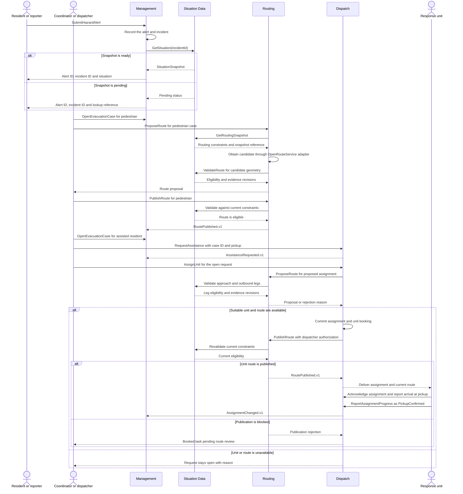
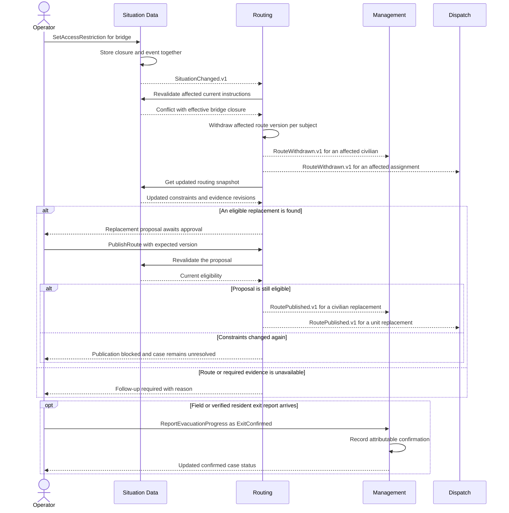

# MVP commands, events and sequence diagrams

This proposed catalog expands the [service contracts](domain-architecture.md#service-contracts) into messages the team can implement and test. It follows the [MVP workflows](business-processes.md) and the shared flood demo in the [work packages](mvp-work-packages.md). See the [service interface specification](mvp-interfaces.md) for HTTP paths, RabbitMQ bindings and example payloads.

## Commands and queries

A command requests an action from the service that owns the affected state. Each command carries a `commandId` and a `correlationId`. Commands that modify a versioned resource also carry `expectedVersion` where concurrent changes can conflict. Authentication supplies the actor and role. An identical retry returns the original outcome. A conflicting reuse of a command ID is rejected.

| Command | Receiving aggregate or service | Main inputs | Result or rejection |
| --- | --- | --- | --- |
| `SubmitHazardAlert` | Management / `EvacuationIncident` | `clientAlertId`, source, `observedAt`, hazard type, point or polygon | `alertId`, `incidentId`, and a situation snapshot or pending reference |
| `OpenEvacuationCase` | Management / `EvacuationCase` | `incidentId`, opaque `subjectRef`, mobility profile | `caseId`; repeat requests for the same known subject and incident resolve to the existing case |
| `ReportEvacuationProgress` | Management / `EvacuationCase` | `caseId`, `reportId`, report type, source, `observedAt`, instruction version if relevant; coordinates and accuracy for a position observation | An updated position view, an explicit milestone confirmation, or a rejected state transition; position alone leaves confirmed progress unchanged |
| `RecordHazardRevision` | Situation Data / `HazardAssessment` | Hazard reference, extent, effective window, source, evidence kind and review status | New hazard revision; an unverified finding stays in the review layer |
| `SetAccessRestriction` | Situation Data / `NetworkSegment` | `segmentId`, restriction type, affected modes, effective window and evidence | Updated segment revision, or rejection for an unauthorized or stale change |
| `ProposeRoute` | Evacuation Routing | `RouteSubject`, start or pickup, eligible exits, mode, mobility or vehicle constraints | Short-lived `proposalId` with route legs and a validation snapshot, or `NoEligibleExit`, `RouteIneligible` or `RoutingProviderUnavailable` |
| `PublishRoute` | Routing / `RouteInstruction` | `RouteSubject`, `proposalId`, expected instruction aggregate version | Current route version and validity after authorization and revalidation, or `VersionConflict`, `ProposalExpired` or `RouteIneligible` |
| `WithdrawRoute` | Routing / `RouteInstruction` | `RouteSubject`, target route version, reason and evidence reference | Target version recorded as withdrawn; a stale command cannot withdraw a newer version |
| `RequestAssistance` | Dispatch / `AssistanceRequest` | `caseId`, pickup point, capabilities required, outbound transport requirement | `requestId` and an open status |
| `AssignUnit` | Dispatch / `AssistanceRequest` and `ResponseUnit` | `requestId`, `unitId` and expected request version. Dispatch obtains and checks a route proposal before booking. | `assignmentId` and a unit booking pending route publication, or `UnitUnavailable`, `RequestAlreadyAssigned` or `RouteIneligible` |
| `ReportAssignmentProgress` | Dispatch / `AssistanceRequest` | `assignmentId`, report ID, step, source and `observedAt` | Accepted acknowledgement, arrival, pickup or completion, or `InvalidTransition` |

`ProposeRoute` stores a candidate in Routing. A proposal leaves the current instruction unchanged. For dispatch, reserve a proposed `assignmentId` before requesting the candidate so Routing and Dispatch can refer to the same task. The booking and assignment commit together in Dispatch. A unit receives the task once a valid route has been published. If publication fails after booking, the dispatcher sees a task pending route review and can obtain a replacement or resolve the booking explicitly.

Queries read current data. `GetSituation` returns the map snapshot or its readiness status. `GetRoutingSnapshot` and `ValidateRoute` return the applicable constraints and the evidence revisions checked. `GetCurrentRoute` and `GetAssignment` let callers reconcile after a timeout, reconnect, or missed event. `GetAvailableUnits` returns candidates for an assignment. Dispatch rechecks availability when it accepts `AssignUnit`.

## Integration events

An integration event describes a committed fact. Publish it through the owner's outbox with `eventId`, `type`, `producer`, `subjectId`, `subjectVersion`, `occurredAt`, `correlationId`, `causationId` and `payload`. `subjectVersion` is the producer's revision for the event subject. `routeVersion` identifies a specific instruction and stays explicit in the payload. Use UTC timestamps and distinguish the time an observation happened from the time it was recorded.

| Event | Publisher | Payload beyond the common envelope | Consumer and effect |
| --- | --- | --- | --- |
| `HazardAlertRecorded.v1` | Management | `incidentId`, `alertId`, reported area reference and evidence status | Situation Data can refresh the view for the reported area. The event preserves the status of the original report. |
| `SituationChanged.v1` | Situation Data | Changed segment IDs or area reference, constraint type, effective window and evidence status | Routing checks affected current instructions; the map refreshes the relevant layer. Unverified review findings can update the map without withdrawing a route. |
| `RoutePublished.v1` | Routing | Route subject, `routeVersion`, snapshot reference, validity and route details reference | Management or Dispatch exposes the new current version. For a response assignment, Dispatch can mark the booked task ready and deliver its route to the unit. |
| `RouteWithdrawn.v1` | Routing | Route subject, withdrawn `routeVersion`, reason code and evidence reference | The recipient view marks that version withdrawn and the operator sees the need for a replacement or follow-up. |
| `AssistanceRequested.v1` | Dispatch | `incidentId`, `caseId`, `requestId` and request state | Management shows that the case is waiting for assistance. Dispatch owns pickup and capability details. |
| `AssignmentChanged.v1` | Dispatch | `requestId`, `assignmentId`, `caseId`, `unitId`, new assignment state and report time | Management reflects the assistance state. Pickup and completion of a unit task remain distinct from confirmation that the person has exited. |
| `CaseProgressChanged.v1` | Management | `caseId`, confirmed milestone, observation time and confirmation reference | The monitor refreshes confirmed progress. A position observation can refresh the map without publishing a confirmed milestone. |

The consumer deduplicates by `eventId` and tracks authoritative revisions. If a consumer misses data needed to interpret a later event, it reloads the affected resource from its owner. For example, receiving a late withdrawal for route version 1 after version 2 was published leaves version 2 current. Use references or role-scoped queries for exact positions and assistance details.

## Sequence 1 Alert, routing and assistance

The scenario uses two cases in the same flood incident. A pedestrian can walk out. The other person needs a pickup and transport out of the zone.

## Sequence 2 Bridge closure and decision update

Continue from the previous sequence while people are still moving. The dashed notifications labeled with `.v1` are integration events. Publish each route event only for the affected subject and its authorized audience. The map uses the latest state available to it and displays pending or unknown delivery status when applicable.

Use the sequence to verify four outcomes in the demo. A repeated alert creates one incident record for that alert. Two concurrent assignment attempts cannot book the same unit. An instruction across the closed bridge is withdrawn before any replacement is published. A pickup report leaves the case open until exit is confirmed separately.
