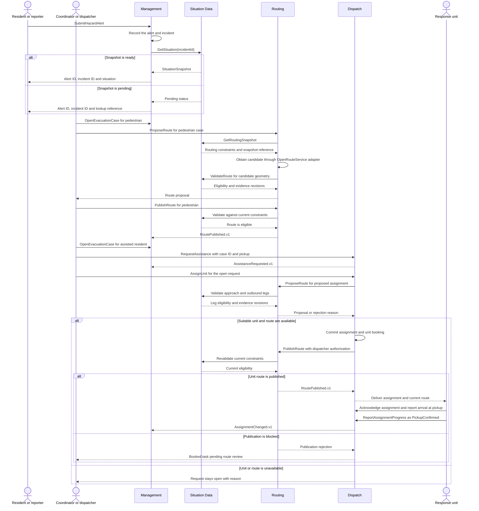
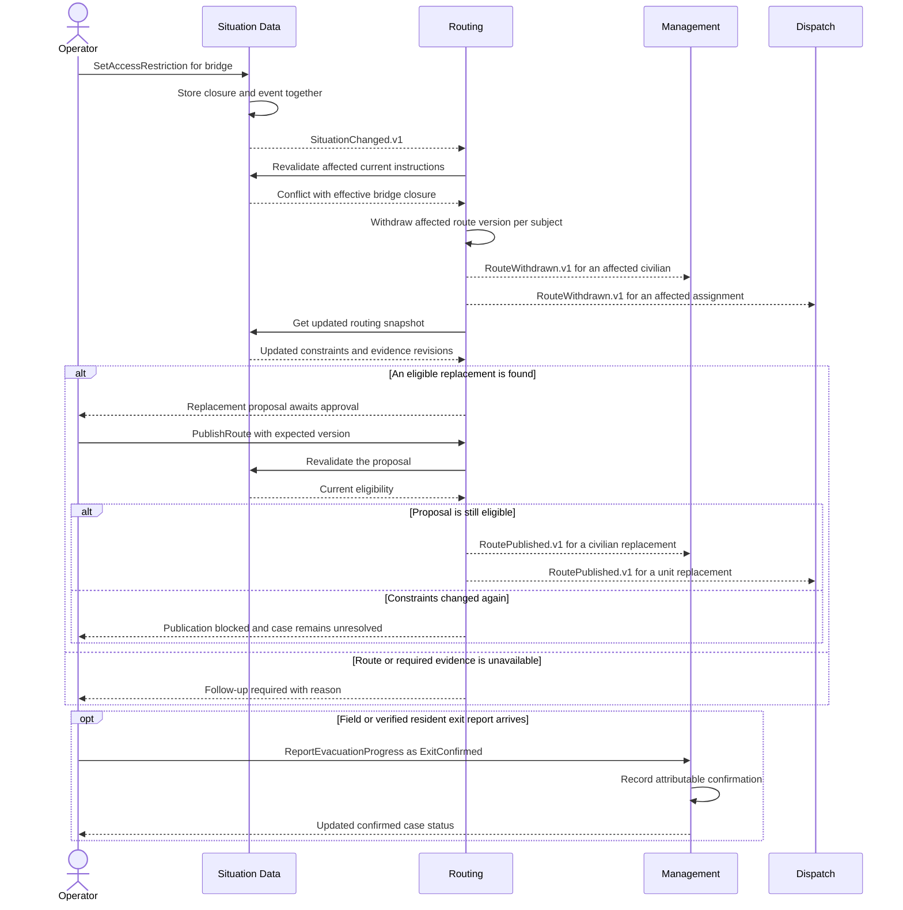
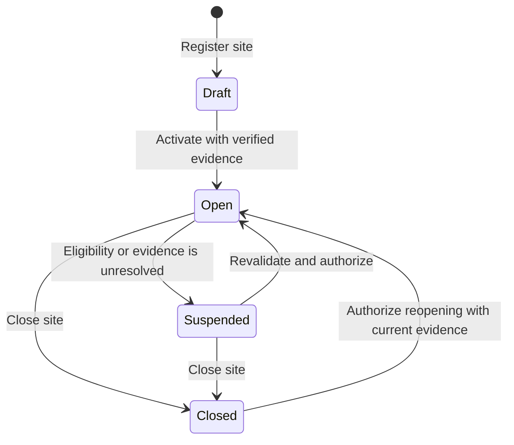
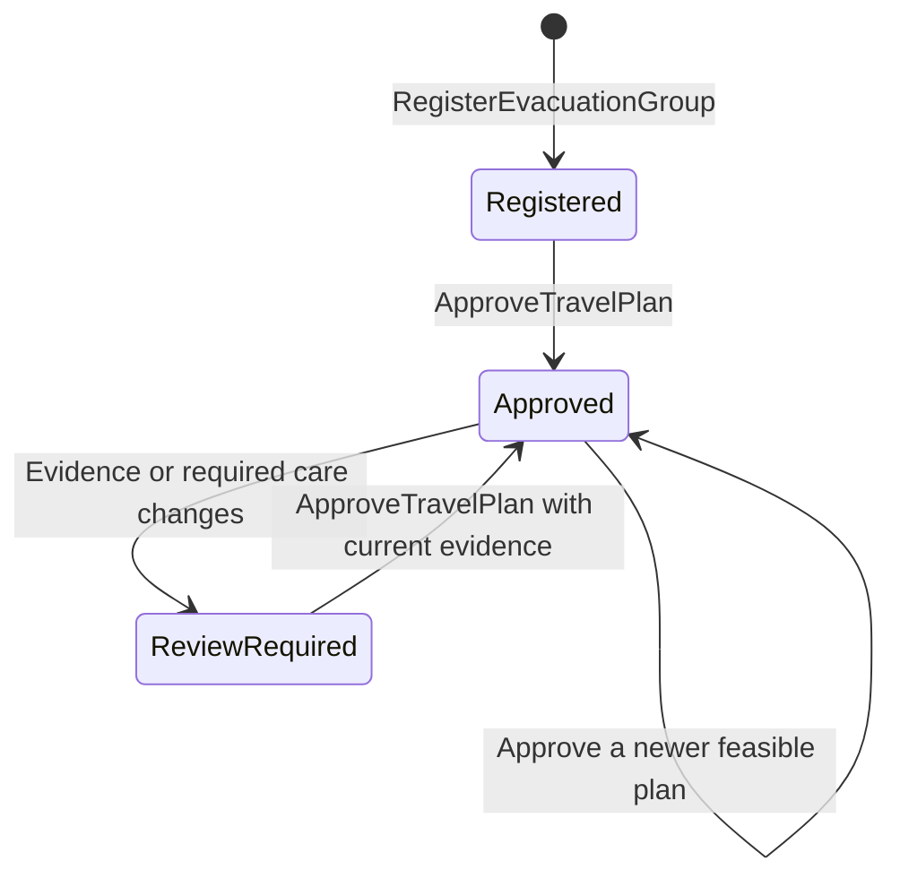
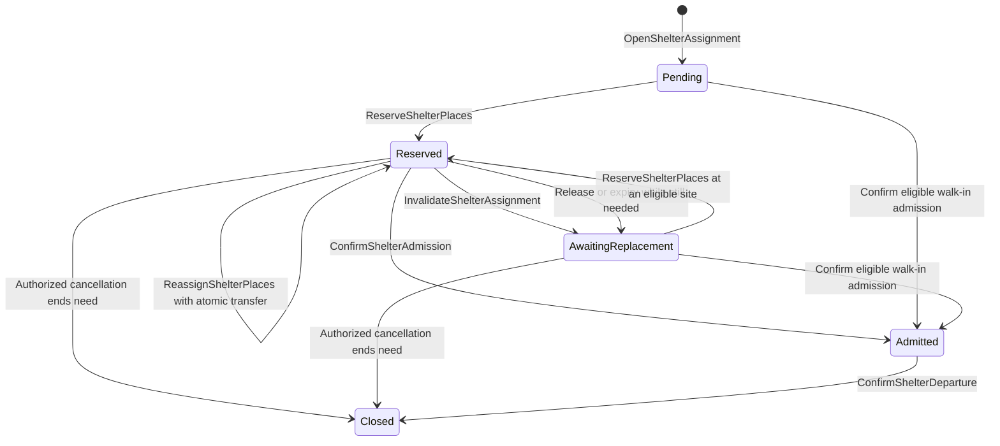
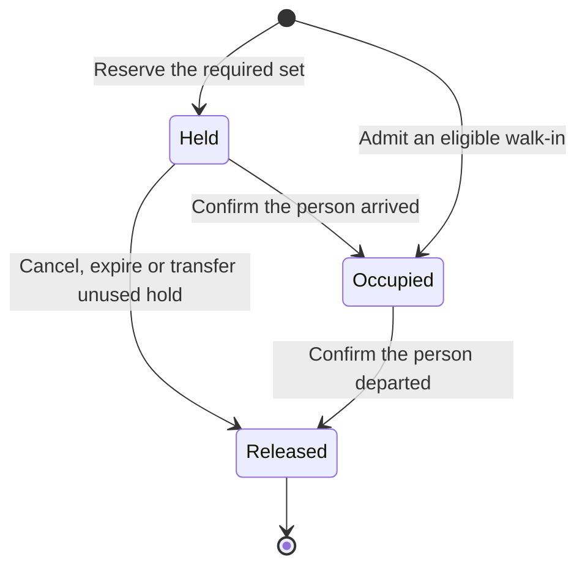
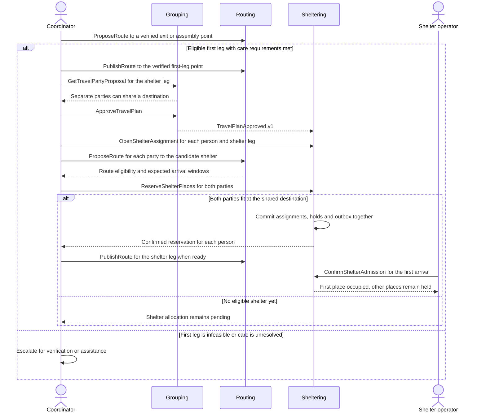
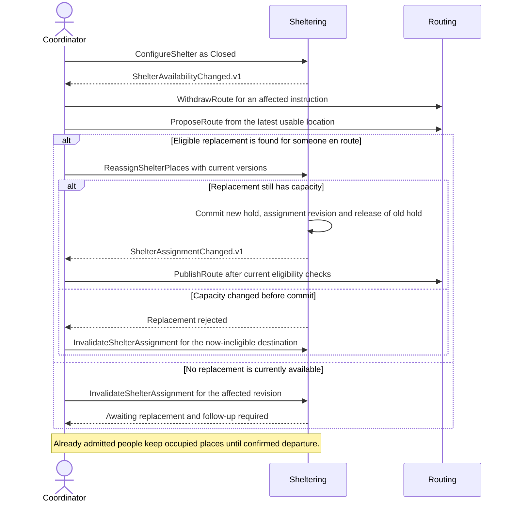

# MVP commands, events and sequence diagrams

This proposed catalog expands the [service contracts](domain-architecture.md#service-contracts) into messages the team can implement and test. It follows the [MVP workflows](business-processes.md) and the shared flood demo in the [work packages](mvp-work-packages.md). See the [service interface specification](mvp-interfaces.md) for HTTP paths, RabbitMQ bindings and example payloads.

## Commands and queries

A command requests an action from the service that owns the affected state. Each command carries a `commandId` and a `correlationId`. Commands that modify a versioned resource also carry `expectedVersion` where concurrent changes can conflict. Authentication supplies the actor and role. An identical retry returns the original outcome. A conflicting reuse of a command ID is rejected.

| Command | Receiving aggregate or service | Main inputs | Result or rejection |
| --- | --- | --- | --- |
| `SubmitHazardAlert` | Management / `EvacuationIncident` | `clientAlertId`, source, `observedAt`, hazard type, point or polygon | `alertId`, `incidentId`, and a situation snapshot or pending reference |
| `OpenEvacuationCase` | Management / `EvacuationCase` | `incidentId`, opaque `subjectRef`, mobility profile | `caseId`; repeat requests for the same known subject and incident resolve to the existing case |
| `ReportEvacuationProgress` | Management / `EvacuationCase` | `caseId`, `reportId`, report type, source, `observedAt`, instruction version if relevant; coordinates and accuracy for a position observation | An updated position view, an explicit milestone confirmation, or a rejected state transition; position alone leaves confirmed progress unchanged |
| `RecordHazardRevision` | Situation Data / `HazardAssessment` | Hazard reference, extent, effective window, source, evidence kind and review status | New hazard revision; an unverified finding stays in the review layer |
| `SetAccessRestriction` | Situation Data / `NetworkSegment` | `segmentId`, restriction type, affected modes, effective window and evidence | Updated segment revision, or rejection for an unauthorized or stale change |
| `ProposeRoute` | Evacuation Routing | `RouteSubject`, start or pickup, eligible exits, mode, mobility or vehicle constraints | Short-lived `proposalId` with route legs and a validation snapshot, or `NoEligibleExit`, `RouteIneligible` or `RoutingProviderUnavailable` |
| `PublishRoute` | Routing / `RouteInstruction` | `RouteSubject`, `proposalId`, expected instruction aggregate version | Current route version and validity after authorization and revalidation, or `VersionConflict`, `ProposalExpired` or `RouteIneligible` |
| `WithdrawRoute` | Routing / `RouteInstruction` | `RouteSubject`, target route version, reason and evidence reference | Target version recorded as withdrawn; a stale command cannot withdraw a newer version |
| `RequestAssistance` | Dispatch / `AssistanceRequest` | `caseId`, pickup point, capabilities required, outbound transport requirement | `requestId` and an open status |
| `AssignUnit` | Dispatch / `AssistanceRequest` and `ResponseUnit` | `requestId`, `unitId` and expected request version. Dispatch obtains and checks a route proposal before booking. | `assignmentId` and a unit booking pending route publication, or `UnitUnavailable`, `RequestAlreadyAssigned` or `RouteIneligible` |
| `ReportAssignmentProgress` | Dispatch / `AssistanceRequest` | `assignmentId`, report ID, step, source and `observedAt`; an authorized dispatcher includes a reason when recording confirmed cancellation | Accepted acknowledgement, arrival, pickup, completion or confirmed cancellation, or `InvalidTransition` |

`ProposeRoute` stores a candidate in Routing. A proposal leaves the current instruction unchanged. For dispatch, reserve a proposed `assignmentId` before requesting the candidate so Routing and Dispatch can refer to the same task. The booking and assignment commit together in Dispatch. A unit receives the task once a valid route has been published. If publication fails after booking, the dispatcher sees a task pending route review and can obtain a replacement or resolve the booking explicitly.

Queries read current data. `GetSituation` returns the map snapshot or its readiness status. `GetRoutingSnapshot` and `ValidateRoute` return the applicable constraints and the evidence revisions checked. `GetCurrentRoute` and `GetAssignment` let callers reconcile after a timeout, reconnect, or missed event. `GetAvailableUnits` returns candidates for an assignment. Dispatch rechecks availability when it accepts `AssignUnit`.

## Integration events

An integration event describes a committed fact. Publish it through the owner's outbox with `eventId`, `type`, `producer`, `subjectId`, `subjectVersion`, `occurredAt`, `correlationId`, `causationId` and `payload`. `subjectVersion` is the producer's revision for the event subject. `routeVersion` identifies a specific instruction and stays explicit in the payload. Use UTC timestamps and distinguish the time an observation happened from the time it was recorded.

| Event | Publisher | Payload beyond the common envelope | Consumer and effect |
| --- | --- | --- | --- |
| `HazardAlertRecorded.v1` | Management | `incidentId`, `alertId`, reported area reference and evidence status | Situation Data can refresh the view for the reported area. The event preserves the status of the original report. |
| `SituationChanged.v1` | Situation Data | Changed segment IDs or area reference, constraint type, effective window and evidence status | Routing checks affected current instructions; the map refreshes the relevant layer. Unverified review findings can update the map without withdrawing a route. |
| `RoutePublished.v1` | Routing | Route subject, `routeVersion`, snapshot reference, validity and route details reference | Management or Dispatch exposes the new current version. For a response assignment, Dispatch can mark the booked task ready and deliver its route to the unit. |
| `RouteWithdrawn.v1` | Routing | Route subject, withdrawn `routeVersion`, reason code and evidence reference | The recipient view marks that version withdrawn and the operator sees the need for a replacement or follow-up. |
| `AssistanceRequested.v1` | Dispatch | `incidentId`, `caseId`, `requestId` and request state | Management shows that the case is waiting for assistance. Dispatch owns pickup and capability details. |
| `AssignmentChanged.v1` | Dispatch | `requestId`, `assignmentId`, `caseId`, `unitId`, new assignment state and report time | Management reflects the assistance state. Pickup and completion of a unit task remain distinct from confirmation that the person has exited. |
| `CaseProgressChanged.v1` | Management | `caseId`, confirmed milestone, observation time and confirmation reference | The monitor refreshes confirmed progress. A position observation can refresh the map without publishing a confirmed milestone. |

The consumer deduplicates by `eventId` and tracks authoritative revisions. If a consumer misses data needed to interpret a later event, it reloads the affected resource from its owner. For example, receiving a late withdrawal for route version 1 after version 2 was published leaves version 2 current. Use references or role-scoped queries for exact positions and assistance details.

## Sequence 1 Alert, routing and assistance

The scenario uses two cases in the same flood incident. A pedestrian can walk out. The other person needs a pickup and transport out of the zone.

## Sequence 2 Bridge closure and decision update

Continue from the previous sequence while people are still moving. The dashed notifications labeled with `.v1` are integration events. Publish each route event only for the affected subject and its authorized audience. The map uses the latest state available to it and displays pending or unknown delivery status when applicable.

Use the sequence to verify four outcomes in the demo. A repeated alert creates one incident record for that alert. Two concurrent assignment attempts cannot book the same unit. An instruction across the closed bridge is withdrawn before any replacement is published. A pickup report leaves the case open until exit is confirmed separately.

## Sheltering and Grouping extension

These proposed contracts implement SH-01 through SH-06 in the [business processes](domain/business-processes.md#detailed-sheltering-and-grouping-workflows). The [aggregate extension](domain-architecture.md#sheltering-and-grouping-extension) describes ownership. The existing command and event contracts above still apply. New writes use the same command IDs, actor authorization and concurrency conventions. For a multi-aggregate command, pass the expected assignment revisions and shelter versions for all affected records. A retry does not reserve a second place, admit a person twice or apply the same handover twice.

### Extension commands

| Command | Owner | Main inputs | Result or rejection |
| --- | --- | --- | --- |
| `SetAssemblyPoint` | Situation Data / `AssemblyPoint` | `incidentId`, `pointId`, place, access profile, operating window, status and evidence | Registers or updates the point. Activation requires a coordinator and current access and hazard evidence. |
| `ConfigureShelter` | Sheltering / `Shelter` | `shelterId`, place, status, operating window, usable quantities by resource type, intake limits and evidence | Updates the site's availability without rewriting confirmed occupancy. A reduction below commitments makes affected reservations visible for review. |
| `RegisterEvacuationGroup` | Grouping / `EvacuationGroup` | `incidentId`, `groupId`, case references, initial typed links and evidence | Creates an incident-scoped group after checking the case references. |
| `UpdateGroupComposition` | Grouping / `EvacuationGroup` | Group reference, membership or relationship changes and evidence | Records a new group revision and marks any affected approved plan for review. Preserves required care unless a handover has been accepted. |
| `RecordCareHandover` | Grouping / `EvacuationGroup` | Dependent case, outgoing and incoming caregivers, effective time and confirmation evidence | Records an authorized, confirmed transfer of care. Rejects missing confirmation or a conflict with the current caregiver. |
| `ApproveTravelPlan` | Grouping / `EvacuationGroup` | Group revision, proposed travel parties, care assignments, shared destination preferences and routing evidence | Approves a plan revision. Rejects a plan that violates required care, access requirements or applicable clearance times. |
| `FlagTravelPlanForReview` | Grouping / `EvacuationGroup` | Target plan revision, reason and changed evidence | Flags an affected approved plan without mutating its historical membership or withdrawing a newer plan. |
| `OpenShelterAssignment` | Sheltering / `ShelterAssignment` | `incidentId`, `caseId`, `legId`, requirements and optional `groupPlanRef` | Opens the pending assignment for this person and leg, or returns the existing one. A first-leg exit instruction can proceed independently. |
| `ReserveShelterPlaces` | Sheltering / `Shelter` and `ShelterAssignment` | `shelterId`, assignment references, resource quantities and expected arrival windows per person, reservation validity, evidence and approval | Commits all requested reservations and updates every affected assignment, or rejects the entire batch with a reason such as `InsufficientCapacity`, `IntakeLimitReached` or `RouteIneligible`. |
| `ConfirmShelterAdmission` | Sheltering / `Shelter` and `ShelterAssignment` when applicable | `shelterId`, case references, admission report ID and time, reservation references if present | Converts only the confirmed arrivals' reserved resources to occupancy. For a walk-in, recheck support and capacity and reconcile any other active reservation before accepting. A repeated report returns the original result. |
| `ConfirmShelterDeparture` | Sheltering / `Shelter` and `ShelterAssignment` when applicable | Shelter and admission references, departure report ID, observation time and evidence | Ends the stay and releases the occupied resources exactly once. |
| `ReleaseShelterReservation` | Sheltering / `Shelter` and `ShelterAssignment` | Reservation and assignment references, reason, and either an authorized cancellation or evidence of agreed expiry | Releases an unused reservation. If shelter is still required, the assignment awaits a replacement. Confirmed admissions retain their occupied resources. |
| `ReassignShelterPlaces` | Sheltering / affected `Shelter` and `ShelterAssignment` roots | Affected assignment revisions, new shelter, eligible route evidence, resource quantities, arrival windows and approval | Reserves the replacement and releases any unused original reservation in the same local transaction. Rejects an attempt to move confirmed occupancy; an admitted person transfers under a new leg. |
| `InvalidateShelterAssignment` | Sheltering / `ShelterAssignment` and `Shelter` | Target assignment revision, reason and evidence that the destination or approach is no longer eligible | Withdraws the affected revision, releases its unused reservation and marks it awaiting replacement. The appropriate publisher withdraws the corresponding route version through Routing. |

Read-only queries include `GetAssemblyPoints` for verified open points, `GetTravelPartyProposal` to evaluate a tentative split, `GetApprovedTravelPlan` for the current group plan and its revision, and `GetShelterAvailability` and `GetShelterAssignment` for capacity review and reconciliation. A candidate trip or capacity result is an estimate until checked by the owner on the write path. Use Routing's proposal and validation workflow for the target location and estimated arrival, whether it is a shelter or an eligible first-leg point.

### Extension events

| Event | Publisher and subject | Payload beyond the common envelope | Main consumers and effect |
| --- | --- | --- | --- |
| `AssemblyPointChanged.v1` | Situation Data / point | Incident, point, operating status, effective window and access evidence reference | Routing and the coordinator view recheck affected first-leg destinations. |
| `EvacuationGroupChanged.v1` | Grouping / group | Incident, group, group revision and reason | The coordinator view and Sheltering reload affected group inputs. |
| `CareHandoverRecorded.v1` | Grouping / group | Incident, group, handover reference and effective time | Authorized planners check affected parties against the current care decision. |
| `TravelPlanApproved.v1` | Grouping / group | Incident, group, plan reference and source revisions | Sheltering can evaluate shared destinations for the approved parties. |
| `TravelPlanReviewRequired.v1` | Grouping / group | Affected plan revision, reason and evidence reference | The coordinator and Sheltering stop using the affected plan for new decisions until reconciled. |
| `ShelterAvailabilityChanged.v1` | Sheltering / shelter | Shelter, operating status, affected resource types, effective window and evidence reference | Coordinator and allocation handlers review capacity, intake and reservations at the affected shelter. |
| `ShelterAssignmentChanged.v1` | Sheltering / assignment | Incident, case, leg, status, active or withdrawn assignment revision, shelter and reservation references where applicable, reason | Coordinator and authorized publication handlers reconcile the destination. A reservation event alone is neither a published route nor an arrival. |
| `ShelterAdmissionConfirmed.v1` | Sheltering / shelter | Admission and case references, applicable assignment reference and observed arrival time | The shelter and coordinator views update occupancy and reception status. |
| `ShelterDepartureConfirmed.v1` | Sheltering / shelter | Admission and case references, applicable assignment reference and observed departure time | The shelter and coordinator views update occupancy and transfer status. |

The subject revision belongs to the publishing aggregate. A group write that invalidates a plan can emit a group change and a review event at the same revision. An admission can likewise change both a shelter and an assignment, producing one event per affected subject. Consumers deduplicate by event ID and use the subject revision to ignore older state, without dropping a distinct event at the same revision. Use references and authorized queries for personal relationships, locations and accessibility information.

Sheltering rechecks affected assignments on relevant `SituationChanged.v1` and `RouteWithdrawn.v1` events. Grouping can use changed evidence to flag only the affected plan revision. The handler compares current versions before withdrawing or replacing anything. If a notification arrives after the corresponding state was superseded, reconcile with the owner and leave the current valid state in place.

### State transitions

**Assembly point or shelter availability.** This lifecycle applies independently to each site function. Only an open and eligible site can be selected. A limit change can also leave a site open while blocking the affected resource or intake slots.

**Group plan.** This tracks whether a group has a usable travel plan. A group may have several travelling parties with one shared destination preference.

**Shelter assignment for one person and leg.** The `Reserved` state confirms the place. Routing separately tracks instruction publication, and delivery and acknowledgement remain separate observations. A failed replacement leaves the original assignment active only while it remains eligible.

**Resource commitment for one reservation or admission.** Partial arrivals change only the commitments of people actually received. A walk-in can consume capacity after an eligible admission check, even when no reservation existed.

### Sequence 3 First leg, shared destination and partial arrival

This example starts with an eligible first leg and no confirmed shelter. The coordinator can publish the first leg immediately while the later shelter leg is still being planned. A direct route to a shelter can be issued instead when the destination and reservation are already confirmed.

### Sequence 4 Replace a destination after a shelter closes

