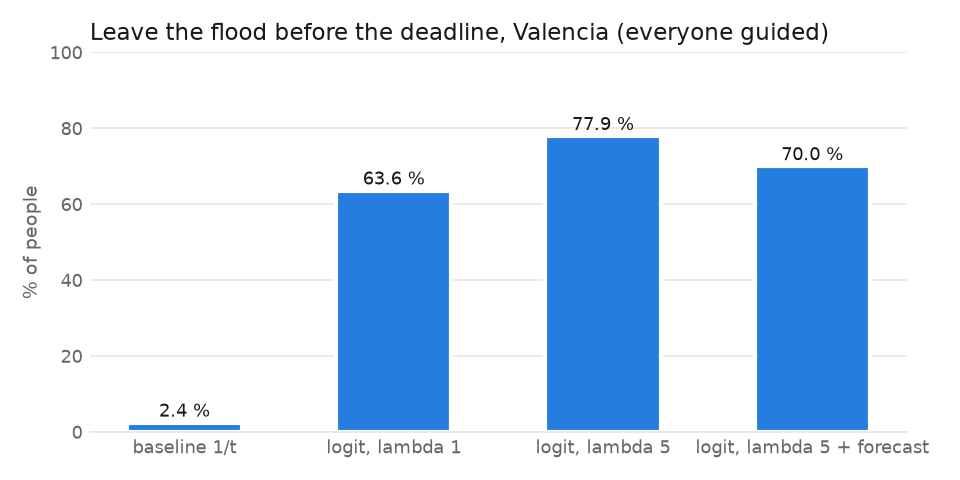
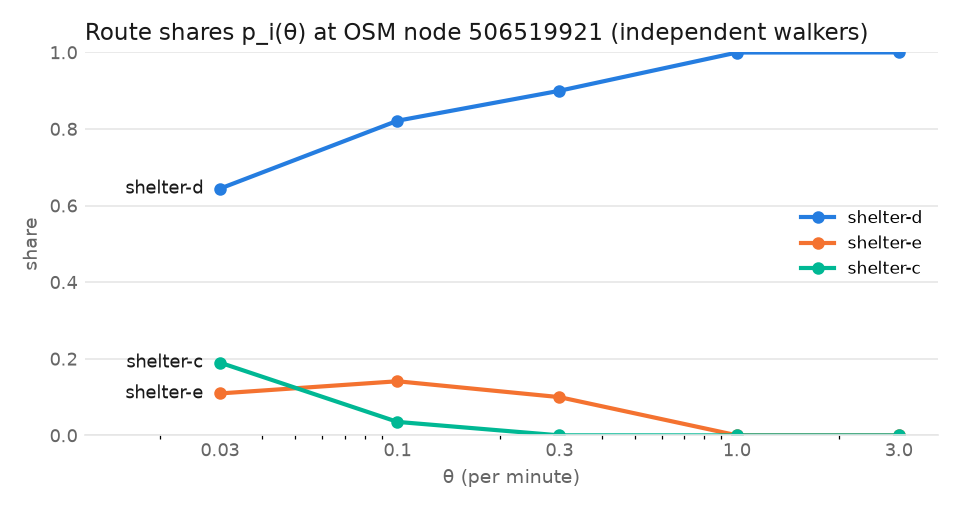

# Route distribution at a node: maths note (task 3)

The note covers the model that decides how the evacuees at a flooded node are spread over shelters and routes. It is the Python reference in [experiments/routing/model.py](../experiments/routing/model.py) and its C# port in [src/Routing/Evacuation](../src/Routing/Evacuation/). The two agree to $10^{-6}$ on the [fixtures](../data/demo/routing/expected.json). The numbers below come from `python experiments/routing/plots.py` on the Valencia W1 graph (63,096 nodes, 91,552 roads). That run uses the GHSL population estimate and 7 **synthetic** shelters.

## 1. What is decided

For every hazard node $n$ and mobility profile $k$, a group of $N_{nk}$ people receives a probability $p_i$ for each eligible shelter $i$. A route draw at the node uses these $p_i$. Each person must **leave the flood** before the node's deadline $D_n$. That deadline is the earlier of an EMS depth rule and $15 + 10\,d$ minutes, where $d$ is the distance in km from the Poyo ravine. The person must also **reach a shelter** while it is still dry and has a place.

## 2. Eligibility

Shelter $i$ is excluded for the group when any of these holds:

- the shortest path crosses a closed road, re-enters the flood from dry ground or, for wheelchair users, uses steps, tracks or paths;
- the shelter has no places left after earlier waves;
- the group would arrive after the forecast limit: $t^{arr}_i > T^{safe}_i$ (section 6).

If no shelter remains, the group gets the state `NoEligibleExit` and never a distribution. Among the eligible shelters, those that let the group leave the flood by $D_n$ are preferred. If none does, the group is `DeadlineInfeasible` and still receives its best options.

## 3. Cost of a route

On road $s$ with free-flow time $t_s$, flow $x_s$ and capacity $C_s$, the congested time is the BPR function, continued along its tangent above capacity:

$$t_s(x) = t_s\Big(1 + \alpha\,(x_s/C_s)^\beta\Big),\qquad \alpha = 0.15,\ \beta = 4.$$

$C_s$ is ten times the nominal pedestrian flow of the graph, an assumption to calibrate. The perceived cost of shelter $i$ is

$$c_i(x) = \sum_{s\in i} \lambda_s\, t_s(x) \;+\; q_i(y_i) \;+\; \mu_i,\qquad \lambda_s = \begin{cases}\lambda = 5 & s \text{ in the flood}\\ 1 & \text{otherwise.}\end{cases}$$

- $\lambda$ makes a flooded second cost five dry seconds, so routes leave the water first. Leave times and deadlines are measured in real seconds.
- $q_i$ is the intake queue at the shelter: $10\,\text{min}\cdot(\text{arrivals per hour}/\text{intake})^2$.
- $\mu_i \ge 0$ is the shadow price of the shelter's places (section 5).

## 4. Logit choice and equilibrium

$$p_i = \frac{e^{-\theta c_i(x)}}{\sum_{j\ \text{eligible}} e^{-\theta c_j(x)}},\qquad \theta = 0.3\ \text{min}^{-1}.$$

Flows depend on choices and choices on flows. The model looks for the stochastic user equilibrium $x = \sum_{n,k} N_{nk} \sum_i p_i(x)\,\delta_i$ with the method of successive averages: $x^{k+1} = x^k + \tfrac1k\,(y^k - x^k)$, where $y^k$ loads the current choices. It stops when the relative gap of the perceived travel time falls below 1 %.

Groups are ordered by free-flow reserve ($D_n$ minus the earliest exit time) into four priority waves. Each wave is assigned on the road and shelter capacity left by the more urgent ones. All waves start at minute 0, because staggering departures cost more time than it saved.

**Limits of θ.** As $\theta\to\infty$, $p_i$ concentrates on the cheapest shelter: all-or-nothing shortest path. As $\theta\to 0$, $p_i$ tends to uniform over the eligible shelters. Both limits are unit tests (`test_theta_limits`).

## 5. Shelter places are a hard limit

After MSA, each shelter's price is raised while its assigned people $y_i$ exceed its places left $R_i$:

$$\mu_i \leftarrow \max\!\big(0,\ \mu_i + 30\,\text{min}\cdot(y_i/R_i - 1)\big).$$

This repeats until no shelter exceeds its places by more than 0.5 %. Prices cannot move a group whose only in-time shelters are all full. Pricing therefore stops once the excess has not fallen by 1 % in 200 iterations, and the remaining excess is cut proportionally. Every group sent to a full shelter keeps a normalised distribution, so it is still guided out of the flood. The cut share $1 - \pi_{nk}$ is reported as `ShelterCapacityExhausted` (`placedShare` $=\pi_{nk}$), never as overflow.

## 6. Forecast window $T^{safe}_i$ (GloFAS)

`IHazardForecast` gives each shelter a river point and a discharge threshold $Q^*_i$ at which the site or its last approach floods. With a forecast series $Q(t)$ at that point,

$$T^{safe}_i = \min\{t : Q(t) \ge Q^*_i\} - t_0,$$

interpolated linearly between samples. $t_0$ is the plan start. A shelter whose threshold is never reached within the series has no limit.

- `MockGlofasForecast` reads a [forecast file](../data/demo/routing/valencia/glofas-forecast.mock.json). The bundled file is synthetic and shaped like the 29 October 2024 Poyo flood. It gives A 60, E 72 and B 96 minutes after 17:00 UTC.
- `LiveGlofasForecast` reads GloFAS river discharge for the same points from the Open-Meteo Flood API (daily values, placed at 12:00 UTC). It reuses the last good forecast for up to 6 h. After that the plan reports `Unavailable` and applies no limit.

The arrival time $t^{arr}_i$ is the real congested time along the chosen path.

## 7. Results (Valencia, everyone guided, no closures)



| Model | On time | p95 minute of leaving the flood | Over shelter capacity | No place (`ShelterCapacityExhausted`) |
| --- | --- | --- | --- | --- |
| Baseline $p_i \propto 1/t_i$ (former demo) | 2.4 % | 96.5 | 26,833 | 0 |
| Logit SUE, $\lambda = 1$ | 63.6 % | 55.1 | 0 | 0 |
| Logit SUE, $\lambda = 5$ | **77.9 %** | **39.4** | 0 | 0 |
| Logit SUE, $\lambda = 5$, with the synthetic forecast | 70.0 % | 54.0 | 0 | 6,761 |

The baseline ignores congestion. It sends people along the shortest roads into the same bottlenecks and overfills two small shelters, F and G. The logit equilibrium spreads people over routes and shelters. $\lambda$ adds 14 points because routes leave the water before heading for the shelter. With the forecast, shelters A, E and B close at minutes 60, 72 and 96. Their late arrivals must go further, and 6,761 people are guided out of the flood without a place they can still reach. The number is an honest signal for the coordinator. It should not be hidden as overflow.

**Effect of θ.** At a single node, θ controls how sharply people concentrate on the cheapest shelter. At OSM node 506519921, the most populated split node, the share of shelter D rises from 0.64 at $\theta = 0.03$ to 1.00 at $\theta = 1$.



At city scale the outcome barely depends on θ. Over $\theta \in \{0.03, 0.1, 0.3, 1, 3\}$, the on-time share is 77.8–78.0 % and p95 is 39.0–40.4 min. The equilibrium equalises costs, so the people θ diverts mostly trade one equally fast option for another. $\theta = 0.3$ per minute keeps visible alternatives for the draw: a 3-minute cost gap is a factor $e^{-0.9} \approx 0.4$. At $\theta = 0.03$, the pricing step leaves 6 people (0.01 %) over capacity, within the 0.5 % tolerance.

**Convergence.** MSA reached a 1 % gap in 12–22 iterations per wave for every θ, against the 100-iteration limit. Shelter loads stayed within the 0.5 % capacity tolerance in every run. With the forecast, the excess that prices could not move was cut by rationing (section 5).

## 8. Assumptions to calibrate

- **Deadlines:** the depth and distance rule is an assumption, not a forecast.
- **Road capacity:** the graph's nominal pedestrian flows × 10.
- **Shelters and forecast:** both are synthetic.
- **Static assignment:** each wave is assigned once, not simulated over time.
- **One path per shelter:** only the shortest path under current costs is used.
- **Rationing:** it cuts groups proportionally and does not reroute the cut share to a shelter that still has places.
- **Live GloFAS:** it is daily and about 5 km per grid cell. It suits river floods over hours to days, not a flash flood on a small ravine.

Reproduce:

```sh
python experiments/routing/plots.py             # runs the model about 8 times, about 5 min
python experiments/routing/plots.py --replot    # redraws the figures from experiments/routing/out/note-numbers.json
```
